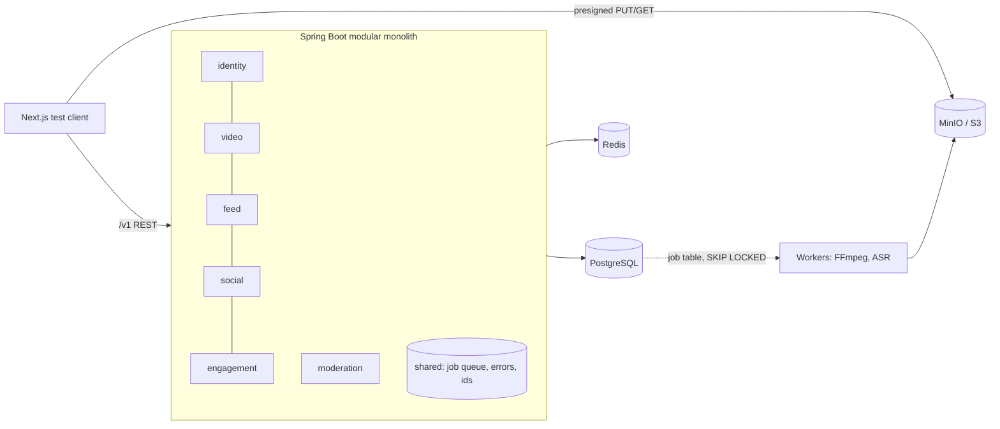

# ProTik

**Short-form video you control, built for expensive data and African languages.**

> **Status: pre-alpha.** The architecture is documented and the first
> decisions are recorded; application code is not written yet. No
> performance, cost or accuracy claim is made until it is measured, with
> hardware and method stated. See the [roadmap](docs/ROADMAP.md).

## Why

Short-video apps are built for cheap data and English-first audiences.
For a Nigerian user on a prepaid mobile plan, that means three problems:

| Problem | ProTik's answer | Measured by |
|---|---|---|
| **Opaque ranking.** You don't know why you see a video. | Every feed item carries structured score components; pick a ranking mode and adjust weights. | Feed p99 latency; score components exposed in the API |
| **Data cost.** Scrolling burns the budget. | Monthly data budget, prefetch cap, 144p and audio-only renditions. | MB per 10 minutes of scrolling, data saver on vs off |
| **Weak African-language support.** Captions and search fail for Yoruba, Igbo, Hausa, Pidgin. | ASR captions and transcript search per language. | Published WER per language, failures included |

We don't claim "better than TikTok." We claim measured numbers.
Full reasoning: [VISION.md](VISION.md).

## Architecture at a glance

A Spring Boot **modular monolith**. Module boundaries are verified by
Spring Modulith in the build; video bytes never touch the app.

Key decisions, each with rejected alternatives:

- [ADR 0001](docs/adr/0001-license-apache-2.md): Apache-2.0
- [ADR 0002](docs/adr/0002-spring-modulith-for-module-boundaries.md): Spring Modulith for module boundaries and events
- [ADR 0003](docs/adr/0003-postgres-backed-job-queue.md): one shared PostgreSQL-backed job queue
- [ADR 0004](docs/adr/0004-asr-evaluation-datasets.md): how ASR quality is measured

## Engineering standards

- Versioned `/v1` API, RFC 9457 errors, cursor pagination, `Idempotency-Key`, correlation IDs
- 3NF schemas, Flyway-only migrations, opaque public IDs
- Rotating refresh tokens with reuse detection; audited moderation actions
- Tests for failure paths; concurrency proven with Testcontainers
- Every ticket ends with updated [DESIGN.md](DESIGN.md), including *what it does not handle*

Details: [CONTRIBUTING.md](CONTRIBUTING.md).

## Stack

Java 25, Spring Boot 4.1, Spring Modulith, PostgreSQL, Redis, MinIO,
FFmpeg, Testcontainers, GitHub Actions. A thin Next.js + TypeScript
client serves as the test harness; the backend is the product.

## Documentation

| Document | Purpose |
|---|---|
| [VISION.md](VISION.md) | Why this exists and how we judge it |
| [docs/ROADMAP.md](docs/ROADMAP.md) | Ordered tickets and milestones |
| [DESIGN.md](DESIGN.md) | Current architecture and its limits |
| [docs/adr/](docs/adr/) | Architecture decision records |
| [CONTRIBUTING.md](CONTRIBUTING.md) | Rules and Definition of Done |
| [SECURITY.md](SECURITY.md) | Reporting vulnerabilities |
| [CODE_OF_CONDUCT.md](CODE_OF_CONDUCT.md) | Community standards |

## Getting started

Not available yet. Build and run instructions arrive with ticket T0.1.

## License

[Apache-2.0](LICENSE).
